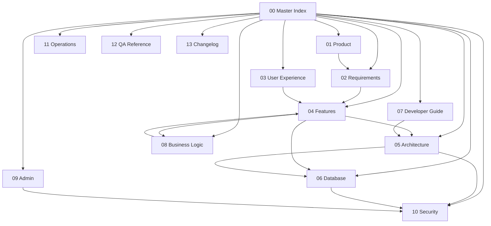

# 🏠 NestMate — Documentation System

> **Version**: 1.0.0  
> **Product**: NestMate — AI-Powered Roommate & Room Discovery Platform  
> **Last Updated**: 2026-07-26  
> **Status**: Production (≈90% Complete)  
> **Team**: 2 Developers | Bootstrap Startup  

---

## Navigation

| # | Section | Description | Status |
|---|---------|-------------|--------|
| 00 | **[Master Index](./00_MASTER_INDEX.md)** | This document — documentation homepage | ✅ Complete |
| 01 | **[Product](./01_PRODUCT/README.md)** | Vision, mission, USP, product philosophy | ✅ Complete |
| 02 | **[Requirements](./02_REQUIREMENTS/README.md)** | PRD, business/functional/non-functional requirements | ✅ Complete |
| 03 | **[User Experience](./03_USER_EXPERIENCE/README.md)** | Personas, journeys, flows, information architecture | ✅ Complete |
| 04 | **[Features](./04_FEATURES/README.md)** | One document per feature — 15 features total | ✅ Complete |
| 05 | **[Architecture](./architecture/SYSTEM_ARCHITECTURE.md)** | System design, PII architecture, database schema | ✅ Complete |
| 06 | **[Database](./architecture/DATABASE_SCHEMA.md)** | Firestore collections, schemas, relationships, indexes | ✅ Complete |
| 07 | **[API Reference](./api/API_REFERENCE.md)** | Custom React hooks and pure helper API specifications | ✅ Complete |
| 08 | **[Deployment & Setup](./deployment/DEPLOYMENT_GUIDE.md)** | Build scripts, deployment, environment setup | ✅ Complete |
| 09 | **[Business Logic](./08_BUSINESS_LOGIC/README.md)** | Algorithms: compatibility, matching, ranking, trust | ✅ Complete |
| 10 | **[Admin](./09_ADMIN/README.md)** | Admin dashboard, moderation, verification workflow | ✅ Complete |
| 11 | **[Security](./10_SECURITY/README.md)** | Auth, authorization, Firestore/Storage rules, validation | ✅ Complete |
| 12 | **[Operations](./11_OPERATIONS/README.md)** | Roadmap, known issues, ADRs, future ideas | ✅ Complete |
| 13 | **[RC1 Archive](./archive/rc1/FINAL_RELEASE_REPORT.md)** | RC1 engineering review, release report, checklist | ✅ Complete |
| 14 | **[Changelog](./13_CHANGELOG/README.md)** | Version history, releases, breaking changes | ✅ Complete |

---

## Document Relationships

## Quick Links by Role

### 🆕 New Developer
1. [Product Vision](./01_PRODUCT/README.md) — What are we building and why
2. [Developer Guide](./07_DEVELOPER_GUIDE/README.md) — Setup and run locally
3. [Architecture](./05_ARCHITECTURE/README.md) — Understand the system
4. [Database](./06_DATABASE/README.md) — Firestore schema
5. [Features](./04_FEATURES/README.md) — Feature-by-feature deep dive

### 📊 Product Manager
1. [Product Vision](./01_PRODUCT/README.md) — Vision and strategy
2. [Requirements](./02_REQUIREMENTS/README.md) — PRD and requirements
3. [User Experience](./03_USER_EXPERIENCE/README.md) — Personas and journeys
4. [Operations](./11_OPERATIONS/README.md) — Roadmap and backlog

### 🎨 Designer
1. [User Experience](./03_USER_EXPERIENCE/README.md) — Full UX documentation
2. [Features](./04_FEATURES/README.md) — UI components per feature
3. [Architecture → Design System](./05_ARCHITECTURE/README.md) — Colors, typography, components

### 🤖 AI Agent Continuing Development
1. [Architecture](./05_ARCHITECTURE/README.md) — Full system map
2. [Database](./06_DATABASE/README.md) — Every collection and schema
3. [Business Logic](./08_BUSINESS_LOGIC/README.md) — Core algorithms
4. [Security](./10_SECURITY/README.md) — Rules and authorization
5. [Operations](./11_OPERATIONS/README.md) — Known issues and future work

### 💼 Investor
1. [Product Vision](./01_PRODUCT/README.md) — Problem, market, USP
2. [Features](./04_FEATURES/README.md) — Capability overview
3. [Operations](./11_OPERATIONS/README.md) — Roadmap

---

## Tech Stack Summary

| Layer | Technology | Version |
|-------|-----------|---------|
| **Frontend** | React | 19.2.0 |
| **Language** | TypeScript | 5.9.3 |
| **Build** | Vite | 7.2.4 |
| **Styling** | Tailwind CSS | 3.4.19 |
| **UI Components** | Radix UI + shadcn/ui | Latest |
| **State** | Zustand | 5.0.12 |
| **Auth** | Firebase Auth | 12.12.1 |
| **Database** | Cloud Firestore | 12.12.1 |
| **Storage** | Firebase Storage | 12.12.1 |
| **Maps** | Leaflet + React-Leaflet | 1.9.4 / 5.0.0 |
| **Charts** | Recharts | 2.15.4 |
| **Forms** | React Hook Form + Zod | 7.70.0 / 4.3.5 |
| **Routing** | React Router | 7.14.1 |
| **Hosting** | Firebase Hosting | — |
| **Geocoding** | Nominatim (OpenStreetMap) | Free API |
| **Payments** | Razorpay (scaffolded) | SDK |

---

## Conventions Used in This Documentation

- **Source code wins** — If documentation conflicts with code, the code is correct
- **Cross-references** use relative links: `[→ Feature Name](../04_FEATURES/feature.md)`
- **Mermaid diagrams** are used for architecture, flows, and relationships
- **Tables** are used for structured data, schemas, and comparisons
- All file paths are relative to the project root `d:\roomate\app\`
