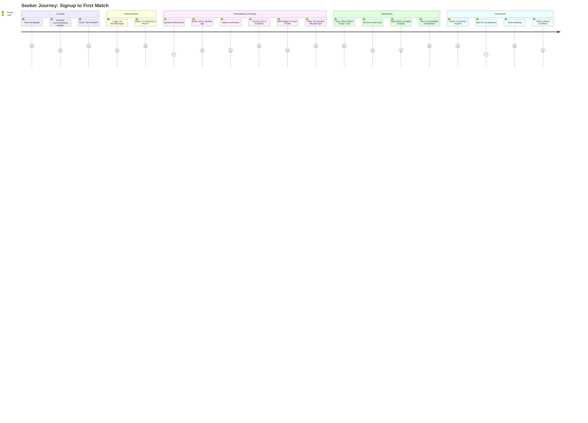
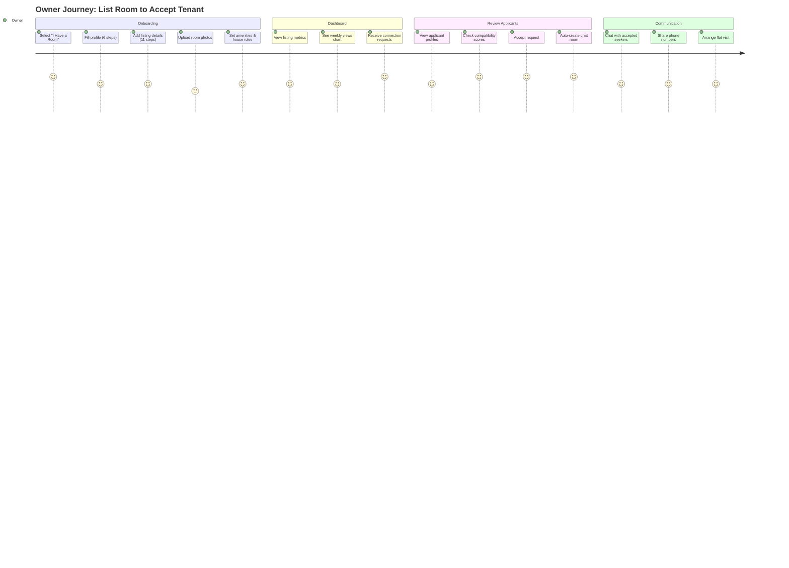
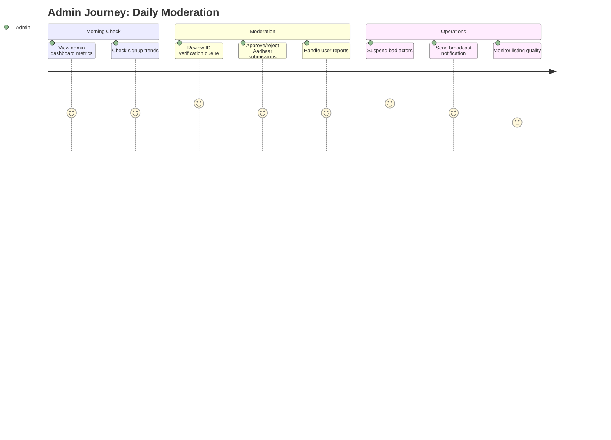
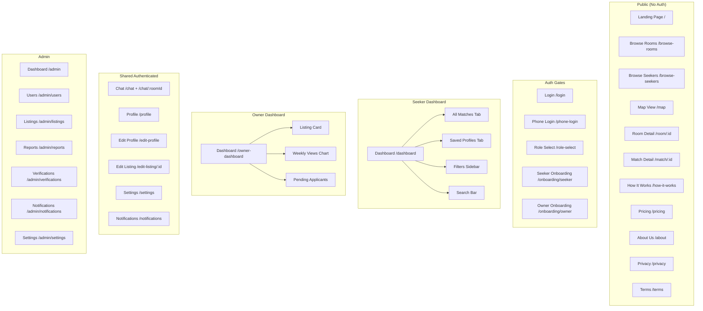
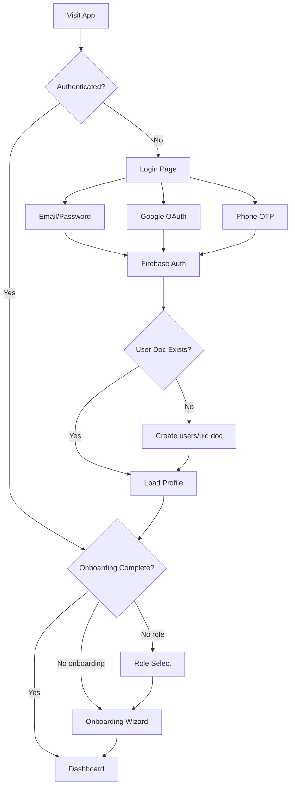
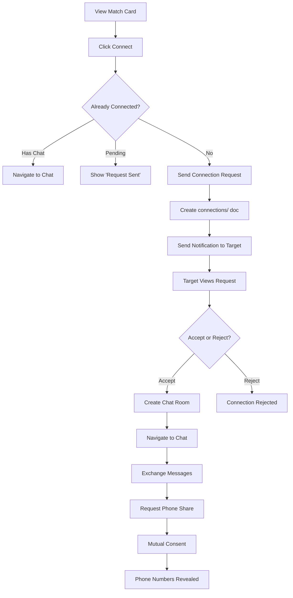
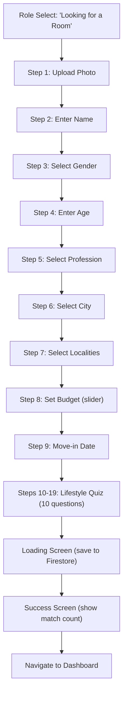

# 03 — User Experience

> **Purpose**: Personas, user journeys, flows, and information architecture  
> **Audience**: Designers, product managers, developers  
> **Dependencies**: [01 Product](../01_PRODUCT/README.md) · [02 Requirements](../02_REQUIREMENTS/README.md)  
> **Related**: [04 Features](../04_FEATURES/README.md)

---

## User Personas

### Persona 1: Rohan — The IT Relocator (Seeker)

| Attribute | Detail |
|-----------|--------|
| **Name** | Rohan Deshmukh |
| **Age** | 25 |
| **Role** | Software Engineer at Razorpay |
| **City** | Bengaluru |
| **Budget** | ₹14,000/mo |
| **Preferred Areas** | HSR Layout, Koramangala, Indiranagar |
| **Lifestyle** | Non-smoker, social drinker, hybrid work, clean, loves pets |
| **Goal** | Find a chill, compatible flatmate near his office |
| **Pain** | Wasted 2 weeks on FB groups; fake listings, no compatibility info |
| **Motivator** | Speed + trust signals (verified profiles, quiz scores) |

### Persona 2: Priya — The Room Owner

| Attribute | Detail |
|-----------|--------|
| **Name** | Priya Sharma |
| **Age** | 28 |
| **Role** | Room Owner (3BHK in HSR Layout) |
| **City** | Bengaluru |
| **Rent** | ₹24,000 total, ₹12,000/partner |
| **Need** | 1 flatmate — neat working professional |
| **Goal** | Find a verified, lifestyle-compatible roommate quickly |
| **Pain** | Past tenant was messy, parties at midnight, left early |
| **Motivator** | Quiz-based matching + verified-only filtering |

### Persona 3: Divya — The Safety-Conscious Female Seeker

| Attribute | Detail |
|-----------|--------|
| **Name** | Divya Nair |
| **Age** | 24 |
| **Role** | Product Designer at Swiggy |
| **City** | Bengaluru |
| **Budget** | ₹15,000/mo |
| **Lifestyle** | Vegetarian, non-smoker, WFH, values cleanliness |
| **Goal** | Female-only flatshare, safe gated society |
| **Pain** | Most platforms don't verify gender or identity |
| **Motivator** | Gender filters + Aadhaar verification + "Verified Pro" badge |

### Persona 4: Admin — Moderation & Operations

| Attribute | Detail |
|-----------|--------|
| **Name** | NestMate Admin |
| **Email** | `*@nestmate.com` |
| **Role** | Platform moderator |
| **Goals** | Verify IDs, resolve reports, monitor metrics, broadcast updates |
| **Tools** | Admin dashboard with 7 sections |

---

## User Journeys

### Journey 1: New Seeker — Signup to First Match

### Journey 2: Owner — List a Room to Accept a Tenant

### Journey 3: Admin — Daily Operations

---

## Information Architecture

### Navigation Map

### Navbar Links by Role

| Role | Links |
|------|-------|
| **Guest** | Find Flatmates · Find Rooms · Map View · Login |
| **Seeker** | Dashboard · Browse Rooms · Messages · Map · Profile |
| **Owner** | Dashboard · Browse Seekers · Messages · Map · Profile |
| **Admin** | All owner/seeker links + Admin Panel |

### Mobile Bottom Nav (Authenticated)

| Position | Seeker | Owner |
|----------|--------|-------|
| 1 | Dashboard | Dashboard |
| 2 | Browse Rooms | Browse Seekers |
| 3 | Messages | Messages |
| 4 | Map | Map |
| 5 | Profile | Profile |

---

## Core User Flows

### Flow 1: Authentication

### Flow 2: Connection & Chat

### Flow 3: Onboarding (Seeker)

---

## Design Patterns

### Mobile-First Patterns

| Pattern | Implementation |
|---------|---------------|
| **Vaul Drawer** | Mobile filters open as bottom sheet (Vaul library) |
| **Bottom Navigation** | 5-icon mobile nav bar, hidden on desktop |
| **Stacked Cards** | Grid → single column on mobile |
| **Touch Targets** | Minimum 44px touch targets |

### Loading State Patterns

| Pattern | Usage |
|---------|-------|
| **Skeleton Shimmer** | Match cards, dashboard stats |
| **Spinner** | Button loading states (`<Loader2>` from Lucide) |
| **Toast Notifications** | Success/error feedback (Sonner) |
| **Optimistic UI** | Skip with undo (5s), save toggle |

### Trust Signal Patterns

| Signal | Visibility |
|--------|-----------|
| Trust Badge | Every match card, profile pages, chat list |
| Verification Icons | ShieldCheck (ID), CheckCircle2 (work email) |
| Active Status | Green dot + text on match cards |
| "NEW" Badge | Profiles created within 7 days |
| Shared Lifestyle Tags | Color-coded match/mismatch on cards |

---

*→ Next: [04 Features](../04_FEATURES/README.md)*
