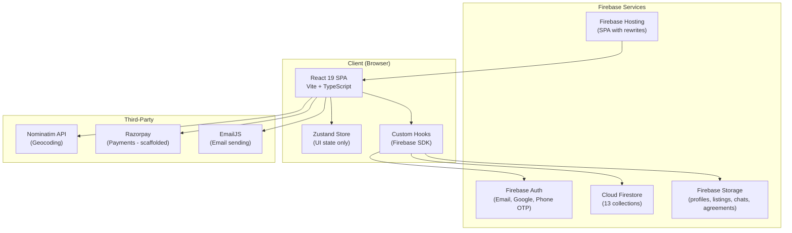
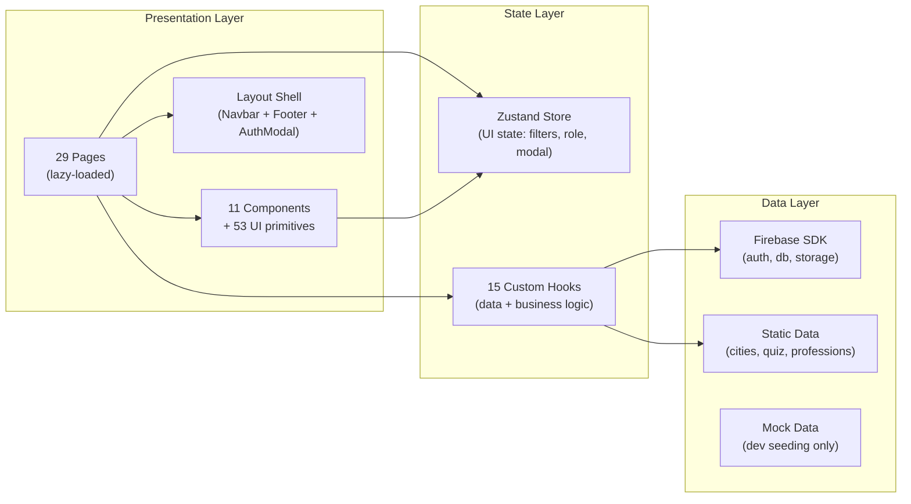
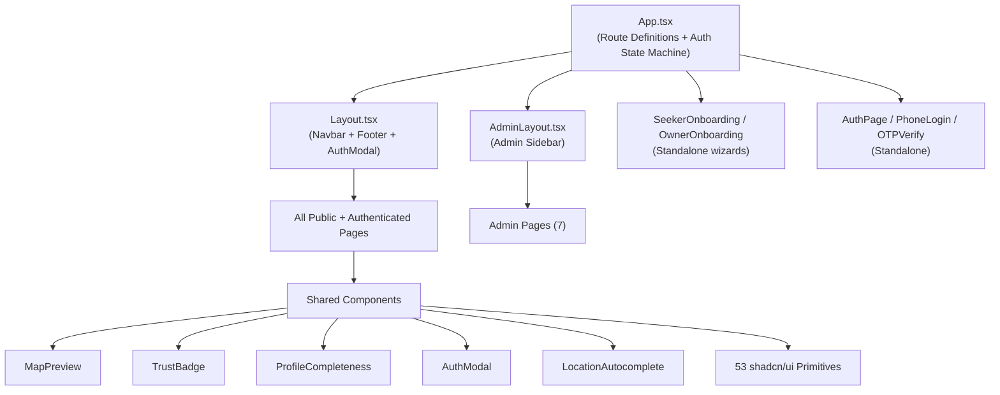
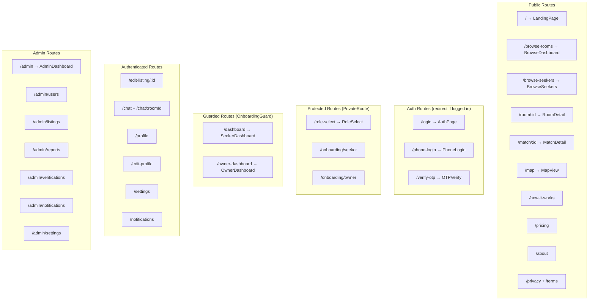

# 05 — Architecture

> **Purpose**: Complete technical architecture of NestMate — from folder structure to deployment  
> **Audience**: Developers, AI agents, technical reviewers  
> **Dependencies**: [04 Features](../04_FEATURES/README.md) · [06 Database](../06_DATABASE/README.md)  
> **Related**: [07 Developer Guide](../07_DEVELOPER_GUIDE/README.md) · [10 Security](../10_SECURITY/README.md)

---

## High-Level Architecture



### Key Architecture Decision: No Backend Server

NestMate operates as a **serverless SPA** — there is no Express/Node backend, no Cloud Functions, and no API server. All business logic runs client-side via Firebase SDK direct connections:

| Layer | Approach |
|-------|----------|
| Authentication | Firebase Auth SDK (client-side) |
| Data operations | Firestore SDK queries (client-side) |
| File uploads | Firebase Storage SDK (client-side) |
| Business logic | Custom React hooks |
| Security | Firestore Security Rules + Storage Rules |
| Hosting | Firebase Hosting with SPA rewrites |

**Rationale**: Bootstrap budget, 2-person team, zero server costs. Firebase free tier covers current scale.

---

## System Design



---

## Folder Structure

```
app/
├── .env                          # Firebase config (VITE_ prefixed)
├── .env.example                  # Template with instructions
├── firebase.json                 # Hosting + Firestore + Storage config
├── firestore.rules               # Firestore security rules (146 lines)
├── firestore.indexes.json        # Composite indexes (12 indexes)
├── storage.rules                 # Storage security rules (31 lines)
├── index.html                    # SPA entry with SEO meta, font preloading
├── package.json                  # 55 dependencies
├── tailwind.config.js            # Design tokens, custom colors, animations
├── vite.config.ts                # Build config with manual chunks
├── tsconfig.app.json             # TypeScript config
│
├── public/
│   ├── robots.txt                # SEO crawl directives
│   ├── sitemap.xml               # SEO sitemap
│   └── sw.js                     # Service worker (push notifications)
│
├── scripts/
│   └── seed-client.ts            # Client-side Firestore seeding script
│
└── src/
    ├── main.tsx                  # React entry point (BrowserRouter)
    ├── App.tsx                   # Route definitions + auth state machine
    ├── App.css                   # Minimal app-level styles
    ├── index.css                 # Design system (CSS variables, components)
    ├── const.ts                  # Shared constants
    │
    ├── api/
    │   └── router.ts             # tRPC scaffold (unused, future)
    │
    ├── components/
    │   ├── AadhaarVerifyModal.tsx # Aadhaar verification modal
    │   ├── AuthLayout.tsx        # Auth page layout wrapper
    │   ├── AuthLayoutSkeleton.tsx # Loading skeleton for auth
    │   ├── AuthModal.tsx         # Global auth prompt modal
    │   ├── DigiLockerModal.tsx   # DigiLocker integration modal
    │   ├── HeroMatchShowcase.tsx # Landing page hero animation
    │   ├── Layout.tsx            # Main app shell (navbar, footer)
    │   ├── LocationAutocomplete  # City/locality autocomplete
    │   ├── MapPreview.tsx        # Leaflet map preview component
    │   ├── ProfileCompleteness   # Profile % meter with nudges
    │   ├── TrustBadge.tsx        # Trust tier badge (Bronze→Pro)
    │   └── ui/                   # 53 shadcn/ui primitives
    │       ├── button.tsx
    │       ├── dialog.tsx
    │       ├── select.tsx
    │       └── ... (53 total)
    │
    ├── hooks/
    │   ├── useAuth.ts            # Auth state, login, signup, OTP, Google
    │   ├── useMatches.ts         # Match finding, compatibility algorithm
    │   ├── useListings.ts        # CRUD listings, views analytics
    │   ├── useChat.ts            # Chat rooms, messages, phone sharing
    │   ├── useConnections.ts     # Connection requests, accept/reject
    │   ├── useNotifications.ts   # CRUD notifications, real-time
    │   ├── useAdmin.ts           # Admin metrics, user/listing mgmt
    │   ├── useUserProfile.ts     # Profile CRUD, save/skip/block/report
    │   ├── useStorage.ts         # File upload to Firebase Storage
    │   ├── useGeocoding.ts       # Nominatim geocoding with rate limit
    │   ├── useReviews.ts         # User reviews/vouches
    │   ├── useActiveTracking.ts  # Last-active timestamp updater
    │   ├── useTranslation.ts     # i18n (en, hi, ta, te)
    │   ├── usePushNotifications  # Browser push + service worker
    │   └── use-mobile.ts         # Mobile breakpoint detection
    │
    ├── lib/
    │   ├── firebase.ts           # Firebase app init (singleton)
    │   ├── utils.ts              # cn() utility (clsx + tailwind-merge)
    │   ├── staticData.ts         # Cities, professions, quiz questions
    │   ├── mockData.ts           # Dev seed data (6 listings, 5 seekers)
    │   └── imageCompressor.ts    # Client-side image resize (Canvas)
    │
    ├── pages/
    │   ├── LandingPage.tsx       # Public homepage (669 lines)
    │   ├── AuthPage.tsx          # Email/Google login/signup
    │   ├── PhoneLogin.tsx        # Phone OTP login (legacy)
    │   ├── OTPVerify.tsx         # OTP verification (legacy)
    │   ├── RoleSelect.tsx        # Seeker vs Owner role selection
    │   ├── SeekerOnboarding.tsx  # 19-step seeker onboarding wizard
    │   ├── OwnerOnboarding.tsx   # 19-step owner onboarding + listing
    │   ├── SeekerDashboard.tsx   # Main seeker feed (1147 lines)
    │   ├── OwnerDashboard.tsx    # Owner listing management
    │   ├── BrowseDashboard.tsx   # Public room browsing
    │   ├── BrowseRooms.tsx       # Room listing browser
    │   ├── BrowseSeekers.tsx     # Seeker browser (for owners)
    │   ├── RoomDetail.tsx        # Room detail page
    │   ├── MatchDetail.tsx       # Match profile detail (826 lines)
    │   ├── ChatPage.tsx          # Real-time messaging
    │   ├── MapView.tsx           # Leaflet full-page map
    │   ├── ProfilePage.tsx       # User's own profile view
    │   ├── EditProfile.tsx       # Profile editing form
    │   ├── EditListing.tsx       # Listing editing form
    │   ├── SettingsPage.tsx      # App settings (4 tabs)
    │   ├── NotificationsPage.tsx # Notification center
    │   ├── PricingPage.tsx       # Pricing tiers display
    │   ├── HowItWorks.tsx        # How it works page
    │   ├── AboutUs.tsx           # About page
    │   ├── PrivacyPolicy.tsx     # Privacy & terms
    │   ├── NotFound.tsx          # 404 page
    │   ├── SeedData.tsx          # Dev data seeding page
    │   └── admin/
    │       ├── AdminLayout.tsx   # Admin shell with sidebar
    │       ├── AdminDashboard.tsx# Metrics dashboard
    │       ├── AdminUsers.tsx    # User management
    │       ├── AdminListings.tsx # Listing moderation
    │       ├── AdminReports.tsx  # Report handling
    │       ├── AdminVerifications# ID verification queue
    │       ├── AdminNotifications# Broadcast system
    │       └── AdminSettings.tsx # Admin config
    │
    ├── providers/                # Empty (Firebase doesn't need providers)
    │
    └── store/
        └── useStore.ts           # Zustand store (UI state only)
```

---

## Component Hierarchy



---

## State Management

### Architecture: Zustand for UI + Firebase Hooks for Data

NestMate uses a **split state architecture**:

| State Type | Managed By | Example |
|-----------|-----------|---------|
| **UI-only state** | Zustand (`useStore`) | Active filters, selected city, auth modal, current role |
| **User data** | `useAuth` hook | Profile, auth state, login/logout |
| **Feature data** | Feature hooks | Matches, listings, chat, connections |
| **Ephemeral state** | Component `useState` | Form inputs, modals, loading states |

### Zustand Store Shape

```typescript
interface AppState {
  currentRole: 'seeker' | 'owner' | null;
  activeChat: string | null;
  selectedCity: string;
  filters: {
    city: string;
    budgetMin: number;        // Default: 1000
    budgetMax: number;        // Default: 25000
    localities: string[];
    gender: string;           // Default: 'any'
    verifiedOnly: boolean;
    flatType: string[];
    furnishing: string[];
    amenities: string[];
  };
  authModalOpen: boolean;
  authModalTitle?: string;
  authModalSubtitle?: string;
  authModalRedirect?: string;
}
```

**Design Decision**: No data persistence in Zustand — all persistent state lives in Firestore. This avoids cache invalidation bugs and ensures real-time consistency.

---

## Routing

### Route Map



### Route Guards

| Guard | Logic | Redirect |
|-------|-------|----------|
| **PrivateRoute** | `!isAuthenticated` → redirect | `/login` |
| **OnboardingGuard** | Not authenticated → `/login`<br/>No role → `/role-select`<br/>Not onboarded → `/onboarding/{role}`<br/>Wrong role → correct dashboard | Context-dependent |
| **AdminLayout** | Checks `useAdmin().isAdmin` | Renders error if not admin |

---

## Service Layer (Custom Hooks)

| Hook | Firestore Collections | Capabilities |
|------|----------------------|-------------|
| `useAuth` | `users` | Sign in (email, Google, phone), sign up, OTP, profile sync |
| `useMatches` | `users`, `matches`, `listings` | Find matches, compatibility scoring, pagination |
| `useListings` | `listings`, `listingViews`, `users` | CRUD listings, weekly views chart, pagination |
| `useChat` | `chatRooms`, `chatRooms/{id}/messages` | Real-time messaging, typing indicators, phone sharing |
| `useConnections` | `connections` | Send/accept/reject/block connections, monthly counting |
| `useNotifications` | `notifications` | CRUD notifications, real-time subscription, browser push |
| `useAdmin` | `users`, `listings`, `chatRooms`, `reports`, `verifications`, `admins`, `config` | Dashboard metrics, user/listing management, broadcasts |
| `useUserProfile` | `users`, `reports` | Profile CRUD, save/skip/block/report |
| `useStorage` | Firebase Storage | Upload profile pics, listing images, chat images |
| `useGeocoding` | `users`, `listings` | Nominatim geocoding with rate limiting |
| `useReviews` | `reviews` | User reviews/vouches CRUD |
| `useActiveTracking` | `users` | Update `lastActiveAt` every 5 minutes |
| `useTranslation` | `users` (reads settings) | i18n for en, hi, ta, te |
| `usePushNotifications` | — | Service worker registration, browser notifications |
| `useIsMobile` | — | Mobile breakpoint detection (768px) |

---

## Build & Deployment

### Build Configuration (Vite)

```typescript
// Manual chunks for optimal caching
manualChunks: {
  'vendor-firebase': ['firebase/app', 'firebase/auth', 'firebase/firestore', 'firebase/storage'],
  'vendor-react': ['react', 'react-dom', 'react-router-dom'],
  'vendor-charts': ['recharts'],
  'vendor-map': ['leaflet', 'react-leaflet'],
}
```

### Deployment Pipeline

```
npm run build          →  vite build → dist/
npm run deploy         →  build + firebase deploy --only hosting
npm run deploy:all     →  build + firebase deploy (hosting + rules + indexes)
```

### Firebase Hosting Config

- **Public directory**: `dist`
- **SPA rewrites**: `** → /index.html`
- **Cache headers**: JS/CSS → `max-age=31536000` (1 year)
- **Security headers**: `X-Frame-Options: SAMEORIGIN`, `X-Content-Type-Options: nosniff`

---

## Third-Party Services

| Service | Usage | Cost | Config |
|---------|-------|------|--------|
| **Firebase Auth** | Email/password, Google OAuth, Phone OTP | Free tier | `.env` variables |
| **Cloud Firestore** | Primary database (13 collections) | Free tier (50K reads/day) | `firestore.rules` |
| **Firebase Storage** | Images (profiles, listings, chats, agreements) | Free tier (5GB) | `storage.rules` |
| **Firebase Hosting** | SPA hosting with CDN | Free tier (10GB/month) | `firebase.json` |
| **Nominatim** | Geocoding (city/locality → lat/lng) | Free (rate-limited 1req/sec) | `useGeocoding.ts` |
| **Razorpay** | Payment processing (scaffolded) | Per-transaction | `VITE_RAZORPAY_KEY_ID` |
| **EmailJS** | Email sending | Free tier | Package installed |
| **Google Fonts** | Lora (display) + Sora (body) | Free | `index.html` preload |

---

## Design System

### Color Palette

| Token | Value | Usage |
|-------|-------|-------|
| `parchment` | `#F7F3ED` | Page background |
| `ink` | `#1A1A2E` | Text, headings |
| `fire` | `#E5501A` | Primary CTA, brand accent |
| `fire-light` | `#FFF0EB` | Fire tinted backgrounds |
| `navy` | `#1E3A5F` | Secondary, dark sections |
| `teal` | `#0D9488` | Success, verified status |
| `cream` | `#F5F0E8` | Subtle backgrounds |
| `gold` | `#D4A843` | Premium, gold badges |

### Typography

| Family | Usage | Weight |
|--------|-------|--------|
| **Lora** (serif) | Headings, display text | 400–700 |
| **Sora** (sans-serif) | Body text, UI elements | 300–700 |

### Component Classes

| Class | Description |
|-------|-------------|
| `.card-nestmate` | White card with `shadow-card`, `rounded-2xl` |
| `.card-nestmate-hover` | Same + hover lift effect |
| `.btn-fire` | Primary CTA button |
| `.btn-navy` | Secondary button |
| `.btn-outline` | Fire-outlined button |
| `.frosted-glass` | Glassmorphism effect |
| `.gradient-fire` | Orange gradient background |
| `.gradient-dark` | Dark navy gradient |
| `.badge-fire/navy/teal/gold` | Colored badge pills |
| `.skeleton-shimmer` | Loading skeleton animation |

---

*→ Next: [06 Database](../06_DATABASE/README.md)*
