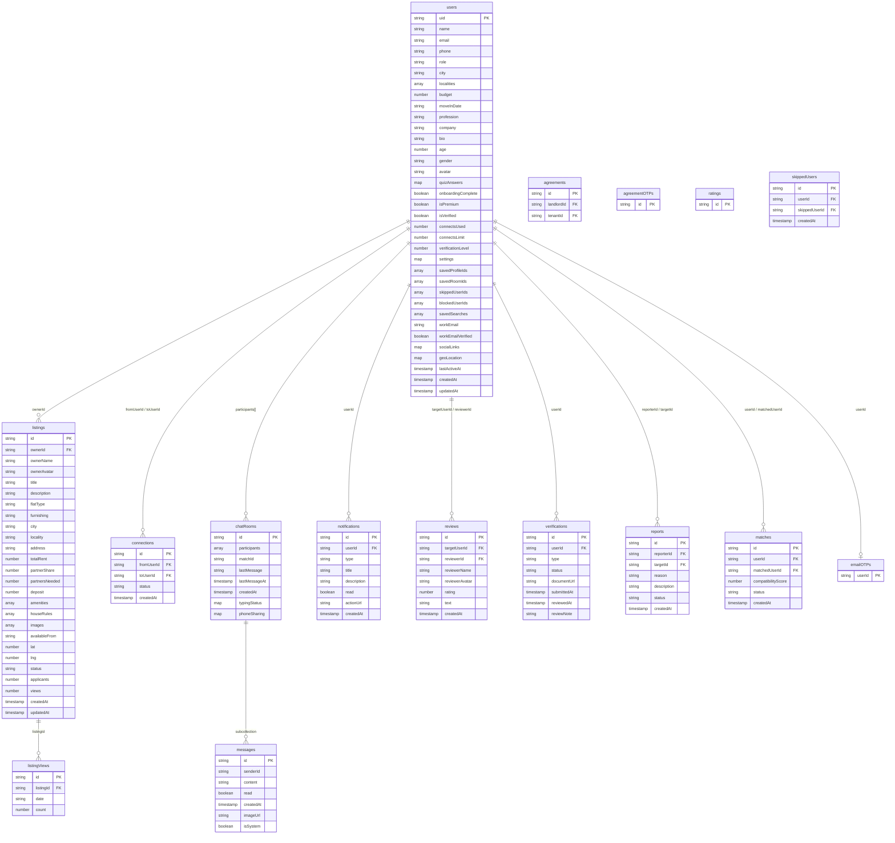
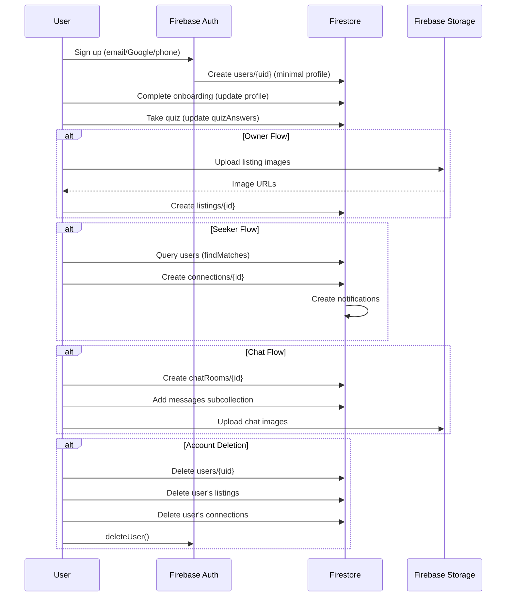

# 06 — Database

> **Purpose**: Complete Firestore schema documentation — every collection, every field, every relationship  
> **Audience**: Developers, AI agents, database administrators  
> **Dependencies**: [05 Architecture](../05_ARCHITECTURE/README.md)  
> **Related**: [10 Security](../10_SECURITY/README.md) · [08 Business Logic](../08_BUSINESS_LOGIC/README.md)

---

## ER Diagram

---

## Firestore Collections

### 1. `users` — User Profiles

**Document ID**: Firebase Auth UID  
**Read**: Public (anyone can browse)  
**Write**: Owner only (or admin)

| Field | Type | Required | Default | Description |
|-------|------|----------|---------|-------------|
| `uid` | `string` | ✅ | Auth UID | Firebase Auth user ID |
| `name` | `string` | ✅ | — | Display name |
| `email` | `string` | ✅ | — | Email address |
| `phone` | `string` | ⬜ | — | E.164 phone number |
| `role` | `string` | ✅ | `null` | `'seeker'` or `'owner'` |
| `city` | `string` | ✅ | — | Selected city |
| `localities` | `string[]` | ⬜ | `[]` | Preferred localities |
| `budget` | `number` | ✅ | `8000` | Monthly budget (₹) |
| `moveInDate` | `string` | ⬜ | — | ISO date string |
| `profession` | `string` | ⬜ | — | Job title |
| `company` | `string` | ⬜ | — | Employer name |
| `bio` | `string` | ⬜ | — | User biography |
| `age` | `number` | ⬜ | `0` | User age |
| `gender` | `string` | ⬜ | — | `'Male'`, `'Female'`, `'Other'` |
| `avatar` | `string` | ⬜ | Unsplash URL | Profile image URL |
| `quizAnswers` | `map<string, string>` | ⬜ | `{}` | Compatibility quiz answers |
| `onboardingComplete` | `boolean` | ✅ | `false` | Whether onboarding is done |
| `isPremium` | `boolean` | ✅ | `false` | Premium subscription status |
| `isVerified` | `boolean` | ✅ | `false` | Government ID verified |
| `connectsUsed` | `number` | ✅ | `0` | Monthly connections used |
| `connectsLimit` | `number` | ✅ | `5` | Monthly connection cap |
| `verificationLevel` | `number` | ✅ | `0` | 0-3 verification tier |
| `settings` | `map` | ⬜ | — | User preferences (dark mode, language, notifications) |
| `savedProfileIds` | `string[]` | ✅ | `[]` | Saved match UIDs |
| `savedRoomIds` | `string[]` | ✅ | `[]` | Saved listing IDs |
| `skippedUserIds` | `string[]` | ✅ | `[]` | Skipped UIDs |
| `blockedUserIds` | `string[]` | ✅ | `[]` | Blocked UIDs |
| `savedSearches` | `array<map>` | ⬜ | `[]` | Saved filter presets |
| `workEmail` | `string` | ⬜ | — | Corporate email |
| `workEmailVerified` | `boolean` | ⬜ | `false` | Corporate email verified |
| `socialLinks` | `map` | ⬜ | — | `{linkedin?, instagram?}` |
| `geoLocation` | `map` | ⬜ | — | `{lat, lng, formattedAddress?}` |
| `lastActiveAt` | `timestamp` | ⬜ | — | Last activity timestamp |
| `createdAt` | `timestamp` | ✅ | `serverTimestamp()` | Account creation |
| `updatedAt` | `timestamp` | ✅ | `serverTimestamp()` | Last profile update |

---

### 2. `listings` — Room Listings

**Document ID**: Auto-generated  
**Read**: Public  
**Write**: Owner (ownerId) or admin; view count updates by any authenticated user

| Field | Type | Required | Default | Description |
|-------|------|----------|---------|-------------|
| `id` | `string` | ✅ | Auto | Document ID |
| `ownerId` | `string` | ✅ | — | Owner's user UID |
| `ownerName` | `string` | ✅ | — | Denormalized owner name |
| `ownerAvatar` | `string` | ⬜ | — | Denormalized owner avatar |
| `title` | `string` | ✅ | — | Listing title |
| `description` | `string` | ✅ | — | Detailed description |
| `flatType` | `string` | ✅ | — | `'1BHK'`, `'2BHK'`, `'3BHK'`, `'Studio'` |
| `furnishing` | `string` | ✅ | — | `'Fully Furnished'`, `'Semi-Furnished'`, `'Unfurnished'` |
| `city` | `string` | ✅ | — | City name |
| `locality` | `string` | ✅ | — | Locality/area name |
| `address` | `string` | ⬜ | — | Full street address |
| `totalRent` | `number` | ✅ | — | Total monthly rent (₹) |
| `partnerShare` | `number` | ✅ | — | Per-person share (₹) |
| `partnersNeeded` | `number` | ✅ | `1` | How many flatmates needed |
| `deposit` | `number` | ⬜ | — | Security deposit amount |
| `amenities` | `string[]` | ⬜ | `[]` | Available amenities |
| `houseRules` | `string[]` | ⬜ | `[]` | House rules |
| `images` | `string[]` | ⬜ | `[]` | Image URLs from Storage |
| `availableFrom` | `string` | ⬜ | — | ISO date string |
| `lat` | `number` | ⬜ | — | Latitude |
| `lng` | `number` | ⬜ | — | Longitude |
| `status` | `string` | ✅ | `'active'` | `'active'`, `'paused'`, `'filled'` |
| `applicants` | `number` | ✅ | `0` | Number of applicants |
| `views` | `number` | ✅ | `0` | Total view count |
| `createdAt` | `timestamp` | ✅ | `serverTimestamp()` | |
| `updatedAt` | `timestamp` | ✅ | `serverTimestamp()` | |

---

### 3. `connections` — Connection Requests

**Document ID**: Auto-generated  
**Read/Write**: Participants only

| Field | Type | Description |
|-------|------|-------------|
| `fromUserId` | `string` | Requester UID |
| `toUserId` | `string` | Target UID |
| `status` | `string` | `'pending'`, `'accepted'`, `'rejected'`, `'blocked'` |
| `createdAt` | `timestamp` | Request timestamp |

---

### 4. `chatRooms` — Chat Rooms

**Document ID**: Auto-generated  
**Read/Write**: Participants only

| Field | Type | Description |
|-------|------|-------------|
| `participants` | `string[]` | Array of 2 user UIDs |
| `matchId` | `string` | Associated match ID |
| `lastMessage` | `string` | Preview text of last message |
| `lastMessageAt` | `timestamp` | Last message timestamp |
| `createdAt` | `timestamp` | Room creation |
| `typingStatus` | `map<string, boolean>` | `{uid: isTyping}` |
| `phoneSharing` | `map` | Phone sharing protocol state |

#### `phoneSharing` Sub-map

| Field | Type | Description |
|-------|------|-------------|
| `requestedBy` | `string?` | UID who requested |
| `requestedAt` | `timestamp?` | When requested |
| `acceptedBy` | `string?` | UID who accepted |
| `acceptedAt` | `timestamp?` | When accepted |
| `ownerPhone` | `string?` | Owner's phone (revealed) |
| `seekerPhone` | `string?` | Seeker's phone (revealed) |

---

### 5. `chatRooms/{roomId}/messages` — Messages (Subcollection)

| Field | Type | Description |
|-------|------|-------------|
| `senderId` | `string` | Sender UID or `'system'` |
| `content` | `string` | Message text |
| `read` | `boolean` | Read status |
| `createdAt` | `timestamp` | Sent timestamp |
| `imageUrl` | `string?` | Optional image attachment |
| `isSystem` | `boolean?` | System-generated message flag |

---

### 6. `notifications`

| Field | Type | Description |
|-------|------|-------------|
| `userId` | `string` | Recipient UID |
| `type` | `string` | `'match'`, `'message'`, `'connect'`, `'room'`, `'agreement'`, `'verification'`, `'system'` |
| `title` | `string` | Notification title |
| `description` | `string` | Notification body |
| `read` | `boolean` | Read status |
| `actionUrl` | `string?` | Deep link URL |
| `createdAt` | `timestamp` | |

---

### 7. `matches`

| Field | Type | Description |
|-------|------|-------------|
| `userId` | `string` | First user UID |
| `matchedUserId` | `string` | Second user UID |
| `compatibilityScore` | `number` | 0-100 compatibility |
| `status` | `string` | `'pending'`, `'accepted'`, `'rejected'` |
| `createdAt` | `timestamp` | |

---

### 8. `reviews` (Vouches)

| Field | Type | Description |
|-------|------|-------------|
| `targetUserId` | `string` | User being reviewed |
| `reviewerId` | `string` | Reviewer UID |
| `reviewerName` | `string` | Reviewer display name |
| `reviewerAvatar` | `string` | Reviewer avatar URL |
| `rating` | `number` | 1-5 star rating |
| `text` | `string` | Review text |
| `createdAt` | `timestamp` | |

---

### 9. `verifications`

| Field | Type | Description |
|-------|------|-------------|
| `userId` | `string` | User who submitted |
| `type` | `string` | `'aadhaar'`, `'work_id'`, `'student_id'` |
| `status` | `string` | `'pending'`, `'approved'`, `'rejected'` |
| `documentUrl` | `string` | Uploaded document URL |
| `submittedAt` | `timestamp` | |
| `reviewedAt` | `timestamp?` | Admin review time |
| `reviewNote` | `string?` | Admin rejection note |

---

### 10. `reports`

| Field | Type | Description |
|-------|------|-------------|
| `reporterId` | `string` | Reporter UID |
| `targetId` | `string` | Reported user UID |
| `reason` | `string` | Report category |
| `description` | `string?` | Details |
| `status` | `string` | `'pending'`, `'reviewed'`, `'resolved'` |
| `createdAt` | `timestamp` | |

---

### 11. `listingViews` — Daily View Analytics

**Document ID**: `{listingId}_{YYYY-MM-DD}`

| Field | Type | Description |
|-------|------|-------------|
| `listingId` | `string` | Listing reference |
| `date` | `string` | ISO date (YYYY-MM-DD) |
| `count` | `number` | View count for that day |

---

### 12–15. Supporting Collections

| Collection | Purpose | Key Fields |
|-----------|---------|------------|
| `ratings` | Star ratings (append-only) | Authenticated create-only |
| `skippedUsers` | Legacy skip tracking | `userId`, `skippedUserId` |
| `agreements` | Rent agreement documents | `landlordId`, `tenantId` |
| `agreementOTPs` | Agreement verification OTPs | — |
| `emailOTPs` | Email verification OTPs | Document ID = user UID |
| `admins` | Admin user registry | `email`, `name`, `role` |
| `config/admin` | Admin configuration | `adminEmails[]` |

---

## Composite Indexes

| Collection | Fields | Scope |
|-----------|--------|-------|
| `users` | `onboardingComplete` ASC, `role` ASC, `city` ASC | COLLECTION |
| `users` | `onboardingComplete` ASC, `city` ASC | COLLECTION |
| `users` | `onboardingComplete` ASC, `role` ASC | COLLECTION |
| `chatRooms` | `participants` CONTAINS, `lastMessageAt` DESC | COLLECTION |
| `listings` | `status` ASC, `city` ASC, `createdAt` DESC | COLLECTION |
| `listings` | `status` ASC, `createdAt` DESC | COLLECTION |
| `listings` | `ownerId` ASC, `createdAt` DESC | COLLECTION |
| `connections` | `fromUserId` ASC, `createdAt` DESC | COLLECTION |
| `connections` | `toUserId` ASC, `status` ASC, `createdAt` DESC | COLLECTION |
| `notifications` | `userId` ASC, `createdAt` DESC | COLLECTION |
| `matches` | `userId` ASC, `createdAt` DESC | COLLECTION |
| `matches` | `matchedUserId` ASC, `createdAt` DESC | COLLECTION |
| `reviews` | `targetUserId` ASC, `createdAt` DESC | COLLECTION |

---

## Storage Buckets

| Path Pattern | Purpose | Max Size | Access |
|-------------|---------|----------|--------|
| `profiles/{userId}/**` | Profile avatars | — | Read: auth'd, Write: owner |
| `listings/{listingId}/**` | Listing images | — | Read/Write: auth'd |
| `chats/{roomId}/**` | Chat image attachments | — | Read/Write: auth'd |
| `agreements/{agreementId}/**` | Agreement PDFs | 20MB | Read: auth'd, Write: auth'd |

---

## Data Lifecycle

---

*→ Next: [07 Developer Guide](../07_DEVELOPER_GUIDE/README.md)*
