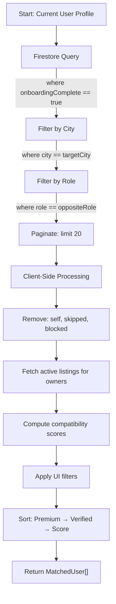
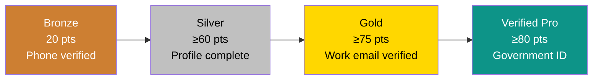
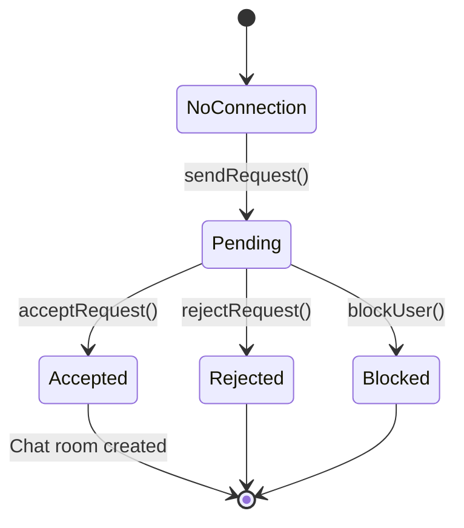
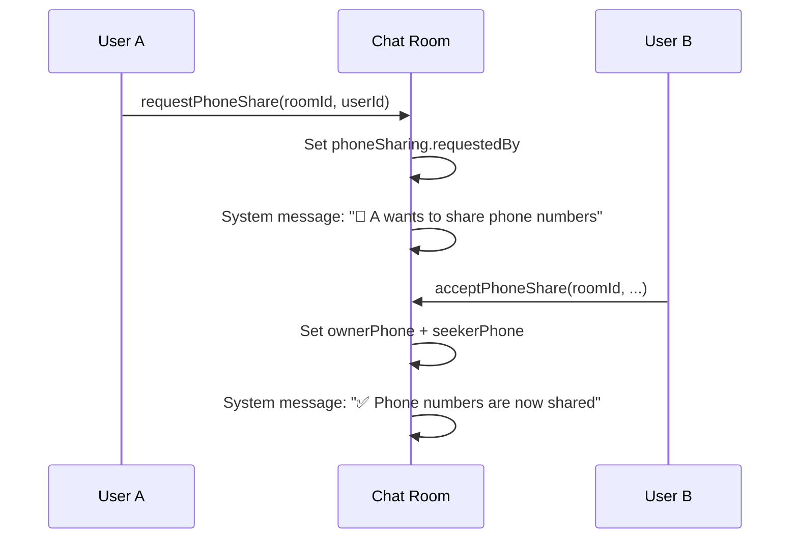

# 08 — Business Logic

> **Purpose**: Document every algorithm, scoring system, and business rule in NestMate  
> **Audience**: Developers, AI agents, product managers  
> **Dependencies**: [06 Database](../06_DATABASE/README.md)  
> **Related**: [04 Features](../04_FEATURES/README.md) · [10 Security](../10_SECURITY/README.md)

---

## Compatibility Algorithm

**Source**: [`useMatches.ts → calculateCompatibility()`](file:///d:/roomate/app/src/hooks/useMatches.ts)

### Overview

The compatibility algorithm computes a percentage (0–100%) measuring lifestyle similarity between two users based on their quiz answers. It is the core differentiator of NestMate.

### Algorithm

```
Input: answersA: Record<string, string>, answersB: Record<string, string>
Output: Integer 0-100

1. Find common keys (questions both users answered)
2. If common keys exist:
   a. For each common key:
      - Parse both values as integers
      - If both parse successfully:
        - diff = |valA - valB|
        - similarity = 1 - min(diff, 3) / 3
        - Scale: 0 diff → 1.0, 1 diff → 0.67, 2 diff → 0.33, 3+ diff → 0.0
      - If string comparison (non-numeric):
        - Exact match → 1.0, else → 0.0
   b. Score = round((totalSimilarity / commonKeys.length) * 100)
3. If no common keys but both have answers:
   a. Union all keys
   b. Count exact string matches
   c. Score = round((matches / unionKeys.length) * 100)
4. If neither has answers: Score = 0
```

### Quiz Questions (10 total)

| # | ID | Question | Options (scored 0-3) |
|---|-----|---------|---------------------|
| 1 | `sleep_time` | Sleep schedule | before_10, 10_to_12, after_12, varies |
| 2 | `wake_time` | Wake-up time | before_6, 6_to_8, 8_to_10, after_10 |
| 3 | `food_pref` | Food preference | veg, non_veg, vegan, no_pref |
| 4 | `smoking` | Smoking habit | never, outside, socially, regularly |
| 5 | `drinking` | Drinking frequency | never, occasionally, socially, regularly |
| 6 | `guests` | Guest frequency | rarely, sometimes, often, very_often |
| 7 | `cleanliness` | Cleanliness importance | very, somewhat, relaxed, messy |
| 8 | `work_mode` | Work mode | wfo, wfh, hybrid, flexible |
| 9 | `pets` | Pet attitude | love, ok, no, allergic |
| 10 | `roommate_gender` | Gender preference | any, female, male, no_pref |

### Design Decisions

- **Distance-based scoring** (not exact-match) means similar-but-not-identical answers still get partial credit
- Max distance is capped at 3, making extreme differences equally bad regardless of scale
- The algorithm is symmetric: `score(A, B) === score(B, A)`
- Missing answers are gracefully handled — partial quizzes still produce scores

---

## Match Finding & Ranking

**Source**: [`useMatches.ts → findMatches()`](file:///d:/roomate/app/src/hooks/useMatches.ts)

### Query Pipeline



### Role-Based Matching Logic

| Current User Role | Sees Users With Role | Why |
|------------------|---------------------|-----|
| `seeker` | `owner` | Seekers want rooms; owners have rooms |
| `owner` | `seeker` | Owners want tenants; seekers need rooms |
| `null` | All roles | Fallback for edge cases |

### Sorting Priority (Triple Sort)

1. **Premium users first** — `isPremium === true` ranks higher
2. **Verified users next** — `isVerified === true` ranks higher
3. **Compatibility score** — Higher % ranks higher

### Client-Side Filters Applied After Firestore Query

| Filter | Type | Logic |
|--------|------|-------|
| `verifiedOnly` | boolean | Exclude non-verified profiles |
| `gender` | string | Exact match on `profile.gender` |
| `budgetMin/Max` | number | Range check on `profile.budget` |
| `localities` | string[] | Intersection with user's localities or listing locality |
| `flatType` | string[] | Match against listing's flatType |
| `furnishing` | string[] | Match against listing's furnishing |
| `amenities` | string[] | ALL selected amenities must be present in listing |

---

## Trust Score System

**Source**: [`TrustBadge.tsx → computeTrustScore()`](file:///d:/roomate/app/src/components/TrustBadge.tsx)

### Trust Ladder



### Scoring Breakdown

| Step | Label | Points | Condition |
|------|-------|--------|-----------|
| 1 | Phone Verified | 20 | Always true (required for signup) |
| 2 | Profile Photo | 15 | Has avatar URL, not a dicebear placeholder |
| 3 | Bio Added | 10 | Bio length ≥ 20 characters |
| 4 | Profession Filled | 10 | `profession` field is non-empty |
| 5 | Compatibility Quiz | 15 | ≥5 quiz answers completed |
| 6 | Work Email Verified | 15 | `workEmailVerified === true` |
| 7 | Government ID | 15 | `isVerified === true` |
| | **Total** | **100** | |

### Tier Assignment Logic

```
if isVerified → "Verified Pro" (regardless of score)
if score ≥ 75 → "Gold"
if score ≥ 45 → "Silver"
else → "Bronze"
```

---

## Profile Completeness

**Source**: [`ProfileCompleteness.tsx → computeCompleteness()`](file:///d:/roomate/app/src/components/ProfileCompleteness.tsx)

### Fields and Weights

| Field | Weight | Condition |
|-------|--------|-----------|
| Profile Photo | 20 | Avatar exists and is non-empty |
| Bio | 15 | Bio ≥ 5 characters |
| Profession | 15 | Profession is non-empty |
| Compatibility Quiz | 25 | ≥5 quiz answers |
| Work Email Verified | 15 | `workEmailVerified` or `workEmail` exists |
| Government ID | 10 | `isVerified` or `verificationLevel ≥ 1` |
| **Total** | **100** | |

### Visual States

| Percentage | Color | Bar |
|-----------|-------|-----|
| < 60% | Amber | `bg-amber-400` |
| 60–84% | Fire/Orange | `bg-fire` |
| ≥ 85% | Teal/Green | `bg-teal` |

---

## Connection Logic

**Source**: [`useConnections.ts`](file:///d:/roomate/app/src/hooks/useConnections.ts)

### Connection State Machine



### Business Rules

1. **Duplicate prevention**: Before creating a connection, checks both directions (`A→B` and `B→A`)
2. **Free tier**: Currently 100% free — unlimited connections (code comment: "Platform is 100% free for all users")
3. **Monthly counting**: `getMonthlyConnectCount()` counts connections created since the 1st of the current month
4. **Constant**: `FREE_CONNECT_LIMIT = 5` (defined but not enforced in current code)

---

## Active Status Tracking

**Source**: [`useActiveTracking.ts`](file:///d:/roomate/app/src/hooks/useActiveTracking.ts)

### Rules

1. Updates `lastActiveAt` in Firestore on user activity events: `mousedown`, `keydown`, `scroll`, `touchstart`
2. **Throttled**: Only writes to Firestore if **5 minutes** have passed since last write
3. **De-duplicated**: Uses a `pendingUpdateRef` to prevent concurrent writes

### Active Status Display

**Source**: [`useMatches.ts → getActiveStatus()`](file:///d:/roomate/app/src/hooks/useMatches.ts)

| Time Since Last Active | Status | Display Text | Dot Color |
|------------------------|--------|-------------|-----------|
| < 15 minutes | `online` | "Active now" | Green |
| < 24 hours | `recent` | "Active Xh ago" | Gray |
| ≥ 24 hours | `offline` | "Active X days ago" | — |

---

## Listing Views Analytics

**Source**: [`useListings.ts → recordView() / getWeeklyViews()`](file:///d:/roomate/app/src/hooks/useListings.ts)

### Write Path

```
recordView(listingId):
  1. Increment listings/{id}.views (total counter)
  2. Upsert listingViews/{listingId}_{YYYY-MM-DD}.count (daily counter)
```

### Read Path (Chart Data)

```
getWeeklyViews(listingId):
  1. Generate last 7 days of date strings
  2. Batch-fetch 7 listingViews documents
  3. Return [{day: 'Mon', views: N}, ...] for Recharts
```

---

## Recommendation Logic (Match Feed)

### How the Feed Works

1. **Primary source**: Firestore query filtered by city, role, onboarding status
2. **Enrichment**: For owner profiles, their active listing data is attached (`_listing` field)
3. **Scoring**: Compatibility algorithm runs for every candidate
4. **Filtering**: Client-side filters reduce the result set
5. **Ranking**: Triple-sort (Premium → Verified → Score)
6. **Pagination**: Firestore cursor-based pagination, 20 per page
7. **Infinite scroll**: Auto-load more when user scrolls to 800px from bottom

### Best Match Highlight

The first match in the sorted list is featured as "Best Match Today" with:
- Larger card with side-by-side layout
- Gold star badge
- Full compatibility breakdown
- Lifestyle tags comparison
- Skip / View Flat / Connect CTAs

---

## Phone Number Sharing Protocol

**Source**: [`useChat.ts → requestPhoneShare() / acceptPhoneShare()`](file:///d:/roomate/app/src/hooks/useChat.ts)

### Flow



### Security
- Phone numbers are **never** displayed until both parties explicitly consent
- Numbers are stored per-room, not globally accessible
- Owner vs seeker role determines which field gets which number

---

## Geocoding Rate Limiting

**Source**: [`useGeocoding.ts`](file:///d:/roomate/app/src/hooks/useGeocoding.ts)

- Uses Nominatim (OpenStreetMap) free API
- **Global queue**: All geocode requests are serialized through a promise chain
- **Rate limit**: 1.1 seconds between requests (Nominatim requires 1req/sec)
- **Query format**: `"{locality}, {city}, India"` or `"{city}, India"`
- Results saved back to Firestore documents

---

## Image Compression

**Source**: [`imageCompressor.ts`](file:///d:/roomate/app/src/lib/imageCompressor.ts)

- **Client-side** compression using HTML5 Canvas
- Max dimensions: 1200×1200px (maintains aspect ratio)
- Output format: JPEG at 80% quality
- Purpose: Keep Firebase Storage usage within free tier limits

---

## Internationalization (i18n)

**Source**: [`useTranslation.ts`](file:///d:/roomate/app/src/hooks/useTranslation.ts)

### Supported Languages

| Code | Language | Coverage |
|------|----------|----------|
| `en` | English | Full (26 keys) |
| `hi` | Hindi | Full |
| `ta` | Tamil | Full |
| `te` | Telugu | Full |

### Implementation
- Language stored in `users/{uid}.settings.language`
- Translation hook reads user preference, falls back to `en`
- Currently covers navigation labels and common UI strings
- Page content is not yet translated (English only)

---

*→ Next: [09 Admin](../09_ADMIN/README.md)*
