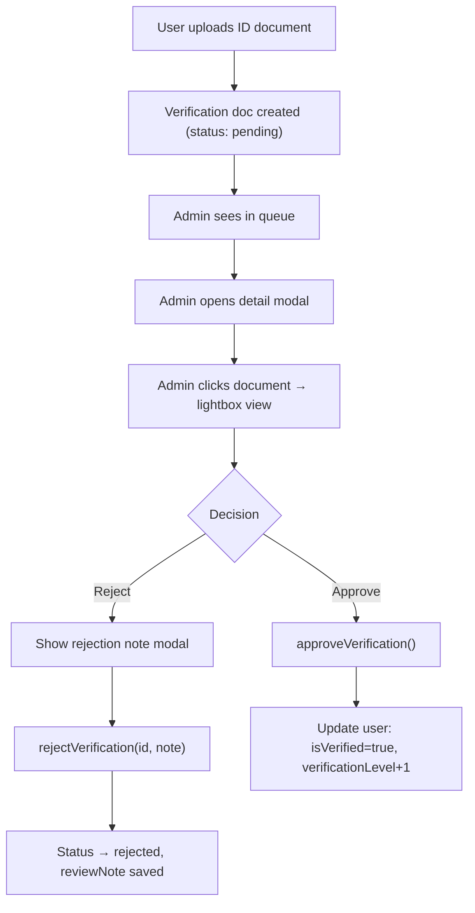

# 09 — Admin

> **Purpose**: Admin panel documentation — capabilities, workflows, access control  
> **Audience**: Developers, platform operators, AI agents  
> **Dependencies**: [04 Features](../04_FEATURES/README.md)  
> **Related**: [10 Security](../10_SECURITY/README.md)

---

## Access Control

### Who is an Admin?

Determined by **email domain check** — no custom claims required:

```
Email ends with @nestmate.com → Admin
```

**Implementation**:
- **Client-side**: `useAdmin.ts` → checks `user.email.endsWith('@nestmate.com')`
- **Firestore rules**: `request.auth.token.email.matches('.*@nestmate\\.com')`
- **Admin route**: `AdminLayout.tsx` renders error state for non-admins

### Admin Infrastructure

| Collection | Purpose |
|-----------|---------|
| `admins` | Registry of admin users (email, name, role, addedAt) |
| `config/admin` | Platform-wide config document with `adminEmails` array |

---

## Admin Pages

### 1. Dashboard (`/admin`)
**Source**: [AdminDashboard.tsx](file:///d:/roomate/app/src/pages/admin/AdminDashboard.tsx)

| Metric | Source | Chart |
|--------|--------|-------|
| New Signups Today | Query users by `createdAt` today | Trend vs yesterday |
| Total Users | Count all users docs | — |
| Active Listings | Count listings with `status: 'active'` | — |
| Active Chats | Count chatRooms | — |
| Seekers vs Owners | Count by `role` field | — |
| Top Cities | Group users by `city` | Bar chart (Recharts) |
| Daily Signups | Last 7 days trend | Line chart (Recharts) |
| Pending Reports | Quick link to reports | — |
| Pending Verifications | Quick link to verifications | — |

---

### 2. User Management (`/admin/users`)
**Source**: [AdminUsers.tsx](file:///d:/roomate/app/src/pages/admin/AdminUsers.tsx)

| Action | Method | Effect |
|--------|--------|--------|
| Browse all users | `getAllUsers()` | Paginated table |
| Search users | Client-side filter by name/email | — |
| View user details | Modal with full profile | — |
| Toggle Premium | `togglePremium(uid)` | Sets `isPremium` on user doc |
| Toggle Verified | `toggleVerified(uid)` | Sets `isVerified` on user doc |
| Suspend user | `suspendUser(uid)` | Sets `suspended: true` |
| Delete user | `deleteUserAccount(uid)` | Deletes user doc + all related data |

---

### 3. Listing Moderation (`/admin/listings`)
**Source**: [AdminListings.tsx](file:///d:/roomate/app/src/pages/admin/AdminListings.tsx)

| Action | Method | Effect |
|--------|--------|--------|
| Browse all listings | `getAllListings()` | Paginated grid/table |
| Filter by status | Client-side | Active, paused, filled |
| Filter by city | Client-side | City dropdown |
| Toggle listing status | `toggleListingStatus()` | Active ↔ Paused |
| Delete listing | `deleteListing()` | Permanent removal |

---

### 4. Report Handling (`/admin/reports`)
**Source**: [AdminReports.tsx](file:///d:/roomate/app/src/pages/admin/AdminReports.tsx)

| Action | Method | Effect |
|--------|--------|--------|
| View all reports | `getAllReports()` | Sorted by date |
| Filter by status | Client-side | Pending, reviewed, resolved |
| View report details | Modal | Reporter + target info |
| Mark as reviewed | `updateReportStatus()` | Status → reviewed |
| Resolve report | `updateReportStatus()` | Status → resolved |

### Report Categories (defined in UI)
- Fake profile
- Harassment
- Inappropriate content
- Spam
- Scam / fraud
- Other

---

### 5. Verification Queue (`/admin/verifications`)
**Source**: [AdminVerifications.tsx](file:///d:/roomate/app/src/pages/admin/AdminVerifications.tsx)

### Workflow



### Verification Types Handled
| Type | Label | ID Field |
|------|-------|----------|
| `aadhaar` | Aadhaar | Government-issued Aadhaar card |
| `work_id` | Work ID | Corporate identity card |
| `student_id` | Student ID | University student card |

---

### 6. Broadcast Notifications (`/admin/notifications`)
**Source**: [AdminNotifications.tsx](file:///d:/roomate/app/src/pages/admin/AdminNotifications.tsx)

| Action | Method | Effect |
|--------|--------|--------|
| Send to all users | `broadcastNotification()` | Creates notification doc for every user |
| Send to role | `broadcastNotification()` | Filter by seeker/owner |
| Custom title + message | Form input | — |

---

### 7. Admin Settings (`/admin/settings`)
**Source**: [AdminSettings.tsx](file:///d:/roomate/app/src/pages/admin/AdminSettings.tsx)

| Setting | Purpose |
|---------|---------|
| Admin Emails | Manage whitelist of admin email addresses |
| Add Admin | Add new `@nestmate.com` email to `admins` collection |
| Remove Admin | Remove admin from collection |

---

## Admin Metrics API

**Source**: [useAdmin.ts → getMetrics()](file:///d:/roomate/app/src/hooks/useAdmin.ts)

### Metric Computation (all client-side)

```
1. Query all users → count total, today's signups, yesterday's signups
2. Query all listings → count active, total
3. Query all chatRooms → count total
4. Group users by city → top cities array
5. Group users by creation date → daily signups for last 7 days
6. Count users by role → seekers vs owners
```

**Note**: All metrics are computed by scanning collections. At scale, this should be replaced with Cloud Functions writing aggregate counters.

---

## Admin Navigation

```
/admin              → Dashboard (metrics overview)
/admin/users        → User Management
/admin/listings     → Listing Moderation
/admin/reports      → Report Handling
/admin/verifications → ID Verification Queue
/admin/notifications → Broadcast System
/admin/settings     → Admin Configuration
```

The admin sidebar is rendered by `AdminLayout.tsx` which wraps all admin pages.

---

*→ Next: [10 Security](../10_SECURITY/README.md)*
