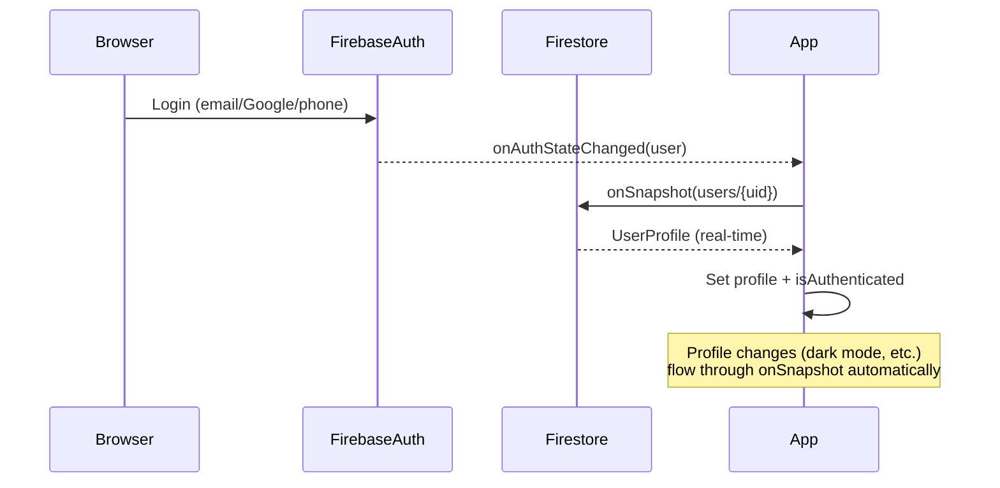
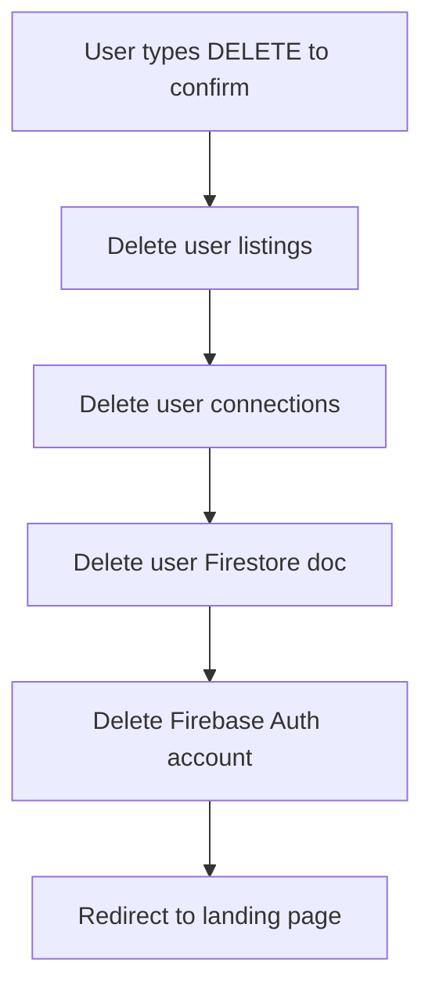

# 10 — Security

> **Purpose**: Authentication, authorization, Firestore rules, Storage rules, client-side validation  
> **Audience**: Developers, security reviewers, AI agents  
> **Dependencies**: [05 Architecture](../05_ARCHITECTURE/README.md) · [06 Database](../06_DATABASE/README.md)  
> **Related**: [09 Admin](../09_ADMIN/README.md)

---

## Authentication Architecture

### Firebase Auth Providers

| Provider | Method | Implementation |
|----------|--------|----------------|
| Email/Password | `createUserWithEmailAndPassword`, `signInWithEmailAndPassword` | `useAuth.ts` |
| Google OAuth | `signInWithPopup(GoogleAuthProvider)` | `useAuth.ts` |
| Phone OTP | `signInWithPhoneNumber` + `RecaptchaVerifier` | `useAuth.ts` |

### Auth State Management



### Key Design Decision
- `onAuthStateChanged` is the **primary auth truth** — mounted in `App.tsx`
- A Firestore `onSnapshot` listener on `users/{uid}` syncs profile data in real-time
- This means profile updates (e.g., admin toggling premium) reflect instantly without page reload

---

## Firestore Security Rules

**Source**: [firestore.rules](file:///d:/roomate/app/firestore.rules) (146 lines)

### Helper Functions

```javascript
function isAuth()      { return request.auth != null; }
function isOwner(uid)  { return request.auth.uid == uid; }
function isAdmin()     { return isAuth() && request.auth.token.email.matches('.*@nestmate\\.com'); }
```

### Rules by Collection

| Collection | Read | Create | Update | Delete |
|-----------|------|--------|--------|--------|
| `users` | ✅ Auth'd | ✅ Auth'd | ✅ Owner or Admin | ✅ Owner or Admin |
| `listings` | ✅ Anyone | ✅ Auth'd | ✅ Owner or Admin (+ view count exception) | ✅ Owner or Admin |
| `connections` | ✅ Participant | ✅ Auth'd | ✅ Participant | ❌ |
| `chatRooms` | ✅ Participant | ✅ Auth'd | ✅ Participant | ❌ |
| `chatRooms/{id}/messages` | ✅ Participant | ✅ Participant | ✅ Participant | ❌ |
| `notifications` | ✅ Owner or Admin | ✅ Auth'd | ✅ Owner or Admin | ✅ Owner or Admin |
| `matches` | ✅ Participant or Admin | ✅ Auth'd | ✅ Participant or Admin | ✅ Admin |
| `reviews` | ✅ Anyone | ✅ Auth'd | ✅ Author | ❌ |
| `verifications` | ✅ Owner or Admin | ✅ Auth'd | ✅ Admin only | ❌ |
| `reports` | ✅ Reporter or Admin | ✅ Auth'd | ✅ Admin | ❌ |
| `listingViews` | ✅ Auth'd | ✅ Auth'd | ✅ Auth'd | ❌ |
| `ratings` | ✅ Auth'd | ✅ Auth'd | ❌ | ❌ |
| `skippedUsers` | ✅ Auth'd | ✅ Auth'd | ❌ | ❌ |
| `agreements` | ✅ Auth'd | ✅ Auth'd | ✅ Auth'd | ❌ |
| `agreementOTPs` | ✅ Auth'd | ✅ Auth'd | ✅ Auth'd | ✅ Auth'd |
| `emailOTPs` | ✅ Owner | ✅ Auth'd | ✅ Owner | ✅ Owner |
| `admins` | ✅ Admin | ✅ Admin | ✅ Admin | ✅ Admin |
| `config` | ✅ Admin | ✅ Admin | ✅ Admin | ✅ Admin |

### Notable Rule Details

#### Listing View Count Exception
```javascript
// Any authenticated user can increment view count
allow update: if isAuth() && 
  request.resource.data.diff(resource.data).affectedKeys().hasOnly(['views', 'updatedAt']);
```

#### Connection Participant Check
```javascript
function isParticipant() {
  return isAuth() && (
    resource.data.fromUserId == request.auth.uid ||
    resource.data.toUserId == request.auth.uid
  );
}
```

#### Chat Room Participant Check
```javascript
function isChatParticipant() {
  return isAuth() && request.auth.uid in resource.data.participants;
}
```

---

## Firebase Storage Rules

**Source**: [storage.rules](file:///d:/roomate/app/storage.rules) (31 lines)

| Path | Read | Write | Size Limit |
|------|------|-------|-----------|
| `profiles/{userId}/**` | Auth'd | Owner only (`userId == uid`) | — |
| `listings/{listingId}/**` | Auth'd | Auth'd | — |
| `chats/{roomId}/**` | Auth'd | Auth'd | — |
| `agreements/{agreementId}/**` | Auth'd | Auth'd | 20MB |

### Validation
- Write allowed only for specific content types: `image/jpeg`, `image/png`, `image/gif`, `image/webp`, `application/pdf`
- Profile images restricted to owner: `request.auth.uid == userId`

---

## Authorization Matrix

### Route-Level Guards

| Route Pattern | Guard | Check |
|--------------|-------|-------|
| `/login`, `/phone-login` | Redirect if auth'd | `isAuthenticated` → redirect to dashboard |
| `/role-select`, `/onboarding/*` | `PrivateRoute` | Must be authenticated |
| `/dashboard`, `/owner-dashboard` | `OnboardingGuard` | Auth'd + role + onboarding complete |
| `/chat`, `/profile`, `/settings` | `PrivateRoute` | Must be authenticated |
| `/admin/*` | `AdminLayout` | `useAdmin().isAdmin` must be `true` |
| `/browse-rooms`, `/map`, etc. | None | Public access |

### Data-Level Authorization

| Operation | Client Check | Firestore Rule |
|-----------|-------------|----------------|
| Edit own profile | `user.uid === profileId` | `isOwner(uid)` |
| Edit own listing | `listing.ownerId === user.uid` | `isOwner(resource.data.ownerId)` |
| Send message | Is participant | `request.auth.uid in resource.data.participants` |
| Admin operations | `email.endsWith('@nestmate.com')` | `isAdmin()` |
| Delete user data | Owner confirmation | `isOwner(uid)` |

---

## Data Privacy

### Phone Number Protection
- Phone numbers stored in `users` collection but **never** displayed on profiles or match cards
- Revealed only through the mutual phone sharing protocol in chat
- Phone sharing state stored per-chat-room in `phoneSharing` map

### Data Export (GDPR Compliance)
- Settings page allows users to download all their data as JSON
- Includes: profile, listings, connections
- Implementation: `SettingsPage.tsx`

### Account Deletion


### Data Minimization
- No analytics SDKs (no Google Analytics, no Mixpanel)
- No third-party tracking pixels
- Geocoding uses privacy-respecting Nominatim (no Google Maps)
- Images compressed client-side before upload (no server processing)

---

## Client-Side Validation

### Onboarding Validation
| Field | Validation | Error Message |
|-------|-----------|---------------|
| Name | Non-empty, min 2 chars | "Please enter your name" |
| Age | Number 18-65 | "Please enter a valid age (18-65)" |
| City | Must select one | "Please select your city" |
| Budget | Min ₹1,000 | Slider enforced |
| Quiz answers | Must answer each question | Per-question validation |

### Listing Validation
| Field | Validation |
|-------|-----------|
| Title | Non-empty |
| Flat type | Must select |
| Furnishing | Must select |
| Rent | Number > 0 |
| City + Locality | Must select |
| At least 1 photo | File upload validation |

### Report Validation
| Field | Validation |
|-------|-----------|
| Reason | Must select from categories |
| Description | Optional free text |

---

## Security Headers

Configured in `firebase.json`:

| Header | Value | Purpose |
|--------|-------|---------|
| `X-Frame-Options` | `SAMEORIGIN` | Prevent clickjacking |
| `X-Content-Type-Options` | `nosniff` | Prevent MIME sniffing |
| `Cache-Control` | `max-age=31536000` (JS/CSS) | Aggressive caching for hashed assets |

---

## Known Security Considerations

| Area | Current State | Risk Level | Recommendation |
|------|--------------|------------|----------------|
| Admin auth | Email domain check only | Medium | Consider Firebase custom claims |
| Connection limits | Defined but not enforced | Low | Enable `FREE_CONNECT_LIMIT` check |
| Rate limiting | Client-side only (geocoding) | Medium | Add Cloud Functions for sensitive ops |
| Input sanitization | No server-side sanitization | Medium | Add Firestore rule field validation |
| CORS | Firebase defaults | Low | Explicitly configure Storage CORS |
| CSP | Not configured | Medium | Add Content-Security-Policy header |

---

*→ Next: [11 Operations](../11_OPERATIONS/README.md)*
