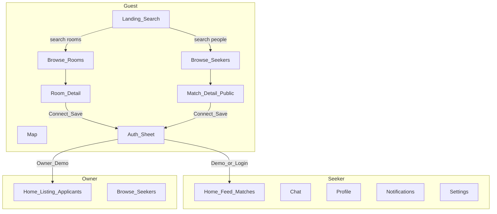

# NestMate — Information Architecture Redesign (Phase 4)

> **Date:** 2026-08-03  
> **Goals:** Reduce scroll & clutter · improve discoverability · one job per screen · bottom-nav-first  
> **Strategy locks:** Guest browse · auth-on-action · explicit Demo only

---

## 1. Mobile sitemap (proposed)

**Marketing pages** (How it works, Pricing, About, Privacy): reachable from profile/menu overflow — not bottom-nav primary.

**Admin:** out of scope.

---

## 2. Navigation model

### Bottom nav (sole primary chrome)

| Slot | Guest | Seeker | Owner |
|------|-------|--------|-------|
| 1 | Explore (Landing/Browse) | Home (matches) | Home (listing) |
| 2 | Rooms | Rooms | Seekers |
| 3 | — | Messages | Messages |
| 4 | Map | Map | Map |
| 5 | Sign in | Profile | Profile |

**Guest Demo:** Not a permanent tab. Lives inside Auth sheet as secondary explicit action (“Try demo”).

### Top bar (slim)
- Logo (home) + **one** utility: Notifications (authed) or Sign in (guest)
- No hamburger competing with bottom nav for primary destinations

---

## 3. Screen inventory — primary job

| Screen | Primary job (one sentence) |
|--------|----------------------------|
| Landing | Start a search (city + intent: rooms or flatmates) |
| Browse rooms | Pick a listing worth opening |
| Browse seekers | Pick a person worth opening |
| Room detail | Decide: save / connect / keep browsing |
| Match detail | Decide: connect based on compatibility story |
| Auth sheet | Sign in, or explicitly start Demo |
| Seeker home | Review ranked matches; open one |
| Owner home | See applicants / listing health; act on one |
| Chat list | Open a conversation |
| Chat thread | Message toward visit / phone share |
| Map | Locate listings geographically |
| Profile | See self; edit / verify |
| Settings | Adjust account preferences |
| Notifications | Triage alerts |
| Filters sheet | Narrow results; Apply |
| Compatibility sheet | Understand full quiz breakdown |

---

## 4. Content priority (Wave 1 critical)

### Landing (first viewport)
1. NestMate brand  
2. One short line of value  
3. Search surface (Rooms | Flatmates + city + locality + Search)  
4. Optional: Instant Demo as quiet text under search  

**Defer below fold:** Social proof, cities grid, how-it-works, showcase carousel (or move showcase to Explore tab secondary).

### Browse rooms
1. Filter chip row + result count  
2. Media cards: photo → rent → locality → 1 trust mark  
3. Map FAB  

### Browse seekers / Match cards
1. Portrait → name → profession/locality → **one** match % → verified mark  
2. One row action (Connect) on detail, not sticker pile on card  

### Room detail (scroll budget)
**Viewport 1:** Gallery + price sticky strip + locality  
**Then:** Title, key facts (beds, gender preference), amenities peek  
**Sticky footer:** Primary Connect/Enquire · secondary Save  
**Sheets:** Full amenities, house rules, map expand  

### Match detail (scroll budget)
**Viewport 1:** Photo + name + verified + match %  
**Then:** 3 compatibility reasons (story)  
**Sticky:** Connect  
**Sheet:** Full lifestyle breakdown (replaces wide table)  

### Auth sheet
1. Title from context (“Connect to message Priya”)  
2. Google / Email / Phone  
3. Explicit Demo seeker / owner (secondary)  

### Chat
List: avatar, name, last message, time — no card frames  
Thread: full-bleed bubbles; composer ≥44px; quiet header  

---

## 5. Progressive disclosure map

| Content | Default | Opens in |
|---------|---------|----------|
| Advanced filters | Chip row summary | Filter sheet + sticky Apply |
| Full compatibility matrix | Hidden | Compatibility sheet |
| All amenities / rules | Peek 4–6 | Sheet or accordion |
| Owner weekly chart | Collapsed summary | Expand / secondary |
| Marketing #1 claims | Removed from hero | — |
| Dual sticky CTAs | Single Connect | Overflow menu for report/share |

---

## 6. Scroll reduction tactics

1. Remove dual chrome → +~56–64px content  
2. Collapse dashboard stats into one header strip  
3. Match detail: story not table  
4. Landing: one hero job  
5. Owner: applicants list first; chart secondary  
6. Filters never dump full form on page  

---

## 7. Wave 1 vs Wave 2 (for wireframes)

**Wave 1 wireframes:** Landing · Browse rooms · Browse seekers · Room detail · Match detail · Auth sheet · Chat list · Chat thread · Shell/bottom nav · Filter sheet · Compatibility sheet  

**Wave 2:** Onboarding chapters · Owner home · Map · Notifications · Profile · Edit profile · Settings · Empty/loading variants  

---

## Exit

IA locked for wireframing. Proceeding to Phase 5 (low-fi Figma).
